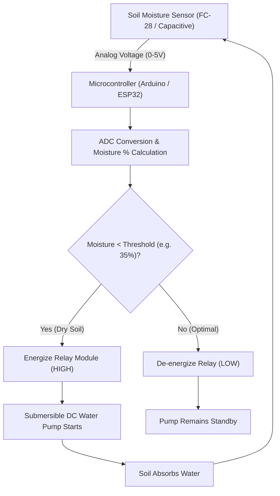

<p align="center">
  
</p>

<p align="center">
  
  
  
  
</p>

<a id="overview"></a>
## 📖 Executive Summary & Overview

Global agricultural operations consume approximately 70% of freshwater withdrawals, with significant losses resulting from manual, uncalibrated watering practices. Implementing an automated, closed-loop irrigation system using real-time soil moisture telemetry prevents under-watering (crop dehydration) and over-watering (soil nutrient runoff and water waste).

The **Smart Irrigation System** (`smart-irrigation-system`) is an embedded IoT automation project completed as part of a Virtual Internship at Alliance University. Detailed in `Smart_Irrigation_System_Detailed.docx`, the architecture integrates soil moisture sensors, analog-to-digital microcontrollers, relay switches, and automated DC submersible water pumps to deliver precision automated hydration based on calibrated moisture thresholds.

<a id="toc"></a>
## 📑 Table of Contents

- [📖 Executive Summary & Overview](#overview)
- [🎯 Key Features & Capabilities](#features)
- [🏗️ System Architecture & Pipeline](#architecture)
- [🛠️ Tech Stack Breakdown](#tech-stack)
- [⚙️ Reproducible Quickstart & Setup](#setup)
- [📁 Project Directory Layout](#project-layout)
- [👨‍💻 Author & Contributions](#author)

<a id="features"></a>
## 🎯 Key Features & Capabilities

- **Real-Time Telemetry Sampling:** Continuous analog voltage readings reflecting volumetric soil moisture percentages.
- **Automated Actuator Loop:** Automated relay triggering activating a 5V/12V DC pump when moisture falls below critical thresholds.
- **Water Conservation Logic:** Hysteresis threshold controls preventing rapid on/off relay cycling.
- **Fail-Safe Mechanism:** Dry-run protection logic and visual LED status indicators.

<a id="architecture"></a>
## 🏗️ System Architecture & Pipeline



<a id="tech-stack"></a>
## 🛠️ Tech Stack Breakdown

| Subsystem | Components | Function |
| :--- | :--- | :--- |
| **Sensing Layer** | Soil Moisture Sensor (Capacitive/Resistive) | Measures soil dielectric permittivity/conductivity |
| **Control Unit** | Microcontroller (Arduino Uno / ESP8266) | ADC polling, threshold comparison, signal routing |
| **Actuator System** | 5V Relay Module & Submersible DC Water Pump | High-voltage/current circuit switching |
| **Documentation** | Academic Internship Report (`.docx`) | Circuit schematics, flowcharts, and evaluation |

<a id="setup"></a>
## ⚙️ Reproducible Quickstart & Setup

### Prerequisites
- Arduino IDE / PlatformIO
- Hardware components: Arduino Uno / ESP32, Soil Moisture Sensor, 5V Relay, Mini Water Pump, Jumper Wires

```bash
# 1. Clone repository
git clone https://github.com/Amaraiah11/smart-irrigation-system.git
cd smart-irrigation-system

# 2. Review system schematics and technical report
# Open 'Smart_Irrigation_System_Detailed.docx' in Microsoft Word or LibreOffice
```

<a id="project-layout"></a>
## 📁 Project Directory Layout

```text
smart-irrigation-system/
├── Smart_Irrigation_System_Detailed.docx # Formal internship project report & circuit blueprint
└── README.md                             # Comprehensive technical documentation
```

<a id="author"></a>
## 👨‍💻 Author & Contributions

This project is developed and maintained with high technical rigour by **Amaraiah C**, Software Engineer and Data Analytics Practitioner studying Bachelor of Computer Applications (BCA) at Alliance University.

- 🌐 **GitHub:** [@Amaraiah11](https://github.com/Amaraiah11)
- 💼 **LinkedIn:** [Connect on LinkedIn](https://www.linkedin.com/in/amaraiah-c/)
- 📧 **Institutional Contact:** `camaraiahBCA24@ced.alliance.edu.in`

### 🤝 Contribution Guidelines
Contributions, bug reports, and architectural discussions are welcome!
1. **Fork** the repository: `https://github.com/Amaraiah11/smart-irrigation-system`
2. **Branch**: `git checkout -b feature/your-feature-name`
3. **Commit**: `git commit -m "feat: enhance feature logic"`
4. **Push**: `git push origin feature/your-feature-name`
5. **Open Pull Request** against the `Amaraiah-C` branch.

---

<p align="center">
  <b>⭐ If this codebase or documentation assisted your engineering workflows, please star the repository! ⭐</b>
</p>

<p align="center">
  
</p>
