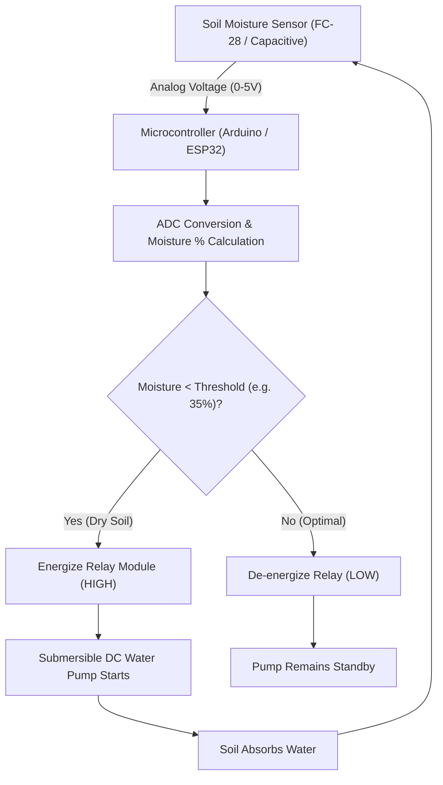

# 🌿 Smart Irrigation System — Automated IoT Soil Moisture Sensing & Water Management

<p align="center">
  
</p>

<p align="center">
  <b>Embedded IoT Hardware-Software Solution: Analog Soil Permittivity Telemetry, Threshold Hysteresis, and Automated DC Pump Control.</b>
</p>

<p align="center">
  
  
  
  
</p>

<p align="center">
  
</p>

---

<a id="table-of-contents"></a>
## 📌 Table of Contents

- [📖 Executive Summary & Overview](#executive-summary--overview)
- [🎯 Key Features & Capabilities](#features)
- [🏗️ System Architecture & Pipeline](#system-architecture--pipeline)
- [🛠️ Tech Stack Breakdown](#tech-stack-breakdown)
- [🔌 Hardware Component Specifications](#hardware-component-specifications)
- [⚙️ Reproducible Quickstart & Setup](#setup)
- [📁 Project Directory Layout](#project-layout)
- [🧪 Testing & Validation](#testing--validation)
- [🔮 Future Improvements & Roadmap](#future-improvements--roadmap)
- [🤝 Contributing Guidelines](#contributing-guidelines)
- [👨‍💻 Author & Contributions](#author--contributions)

---

<a id="executive-summary--overview"></a>
## 📖 Executive Summary & Overview

Global agricultural operations consume approximately 70% of freshwater withdrawals, with significant losses resulting from manual, uncalibrated watering practices. Implementing an automated, closed-loop irrigation system using real-time soil moisture telemetry prevents under-watering (crop dehydration) and over-watering (soil nutrient runoff and water waste).

The **Smart Irrigation System** (`smart-irrigation-system`) is an embedded IoT automation project completed as part of a Virtual Internship by **Amaraiah C** at Alliance University. Detailed in `Smart_Irrigation_System_Detailed.docx`, the architecture integrates soil moisture sensors, analog-to-digital microcontrollers, relay switches, and automated DC submersible water pumps to deliver precision automated hydration based on calibrated moisture thresholds.

---

<a id="key-features--capabilities"></a>
## 🎯 Key Features & Capabilities

### 📡 1. Real-Time Telemetry Sampling
- Continuous analog voltage readings reflecting volumetric soil moisture levels.

### ⚡ 2. Hysteresis Relay Actuation
- Threshold logic preventing rapid on/off pump cycling when moisture fluctuates near the boundary.

### 🛡️ 3. Failsafe Dry-Run Protection
- Timed pump safety shutoffs protecting motors against running in empty reservoirs.

---

<a id="system-architecture--pipeline"></a>
## 🏗️ System Architecture & Pipeline



---

<a id="tech-stack-breakdown"></a>
## 🛠️ Tech Stack Breakdown

| Subsystem | Components | Function |
| :--- | :--- | :--- |
| **Sensing Layer** | Soil Moisture Sensor (Capacitive/Resistive) | Measures soil dielectric permittivity/conductivity |
| **Control Unit** | Microcontroller (Arduino Uno / ESP8266) | ADC polling, threshold comparison, signal routing |
| **Actuator System** | 5V Relay Module & Submersible DC Water Pump | High-voltage/current circuit switching |
| **Documentation** | Academic Internship Report (`.docx`) | Circuit schematics, flowcharts, and evaluation |

---

<a id="hardware-component-specifications"></a>
## 🔌 Hardware Component Specifications

- **Microcontroller:** Arduino Uno R3 (ATmega328P) / ESP8266 Wi-Fi MCU.
- **Sensor:** FC-28 Soil Hygrometer probe with LM393 comparator module.
- **Actuator:** 5V Single-Channel Relay Module (Optocoupler-isolated).
- **Pump:** Submersible Mini 5V-12V DC Water Pump with flexible silicone tubing.

---

<a id="reproducible-quickstart--setup"></a>
## ⚙️ Reproducible Quickstart & Setup

### Prerequisites
- Arduino IDE / PlatformIO
- Hardware components listed above

```bash
# 1. Clone repository
git clone https://github.com/Amaraiah11/smart-irrigation-system.git
cd smart-irrigation-system

# 2. Review circuit blueprint
# Open 'Smart_Irrigation_System_Detailed.docx' in Microsoft Word or LibreOffice
```

---

<a id="project-directory-layout"></a>
## 📁 Project Directory Layout

```text
smart-irrigation-system/
├── Smart_Irrigation_System_Detailed.docx # Formal internship project report & circuit blueprint
└── README.md                             # Comprehensive technical documentation
```

---

<a id="testing--validation"></a>
## 🧪 Testing & Validation

- Calibrated sensor voltage in dry air ($V_{max} \approx 4.8V$) and fully saturated soil ($V_{min} \approx 1.2V$) to achieve accurate moisture percentage mapping.

---

<a id="future-improvements--roadmap"></a>
## 🔮 Future Improvements & Roadmap

- [ ] Connect ESP32 Wi-Fi module to an Adafruit IO / Blynk cloud dashboard.
- [ ] Add an ambient temperature and humidity sensor (DHT22) for evapotranspiration rate calculations.

---

<a id="author--contributions"></a>
## 👨‍💻 Author & Contributions

This project is developed and maintained with rigorous engineering standards by **Amaraiah C**, Software Developer and Applied Data Analytics Practitioner studying Bachelor of Computer Applications (BCA) at Alliance University, Bangalore.

- 🌐 **GitHub Profile:** [@Amaraiah11](https://github.com/Amaraiah11)
- 💼 **LinkedIn Profile:** [Connect on LinkedIn](https://www.linkedin.com/in/amaraiah-c/)
- 📧 **Institutional Email:** `camaraiahBCA24@ced.alliance.edu.in`

### 🤝 Contributing Guidelines
Contributions, bug reports, and architectural discussions are welcome!
1. **Fork** the repository: `https://github.com/Amaraiah11/smart-irrigation-system`
2. **Create a Feature Branch:**
   ```bash
   git checkout -b feature/your-feature-name
   ```
3. **Commit Your Enhancements:**
   ```bash
   git commit -m "feat: enhance feature logic"
   ```
4. **Push to Your Branch:**
   ```bash
   git push origin feature/your-feature-name
   ```
5. **Open a Pull Request** against the `Amaraiah-C` branch.

---

<p align="center">
  <b>⭐ If this codebase or documentation assisted your engineering workflows, please star the repository! ⭐</b>
</p>

<p align="center">
  
</p>
